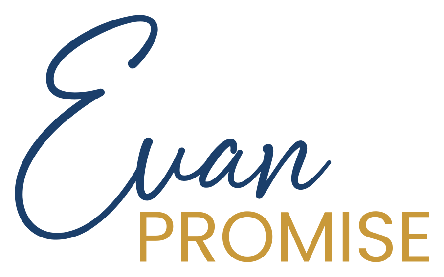
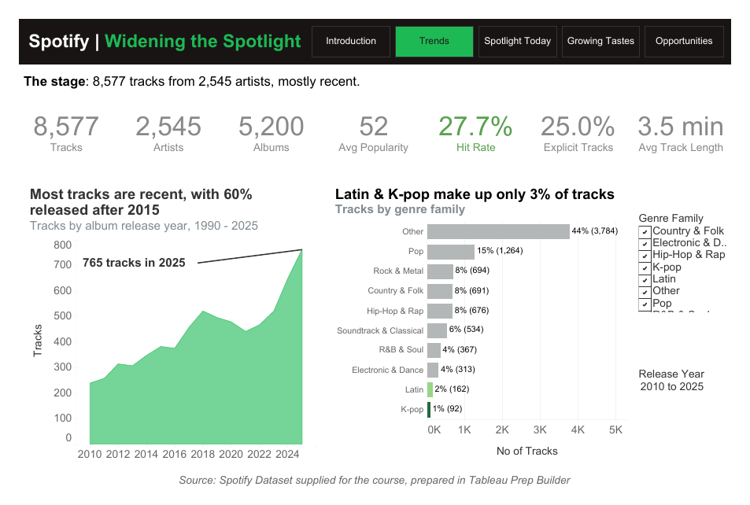
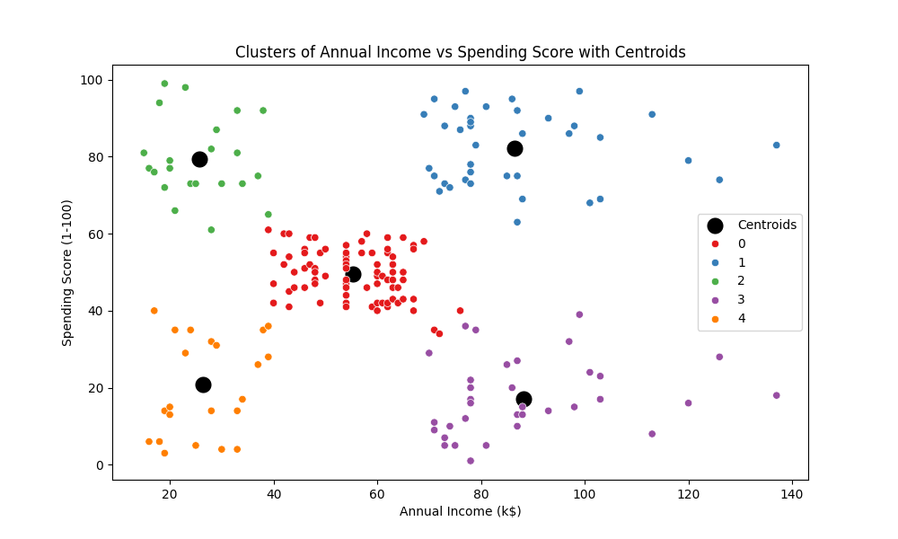
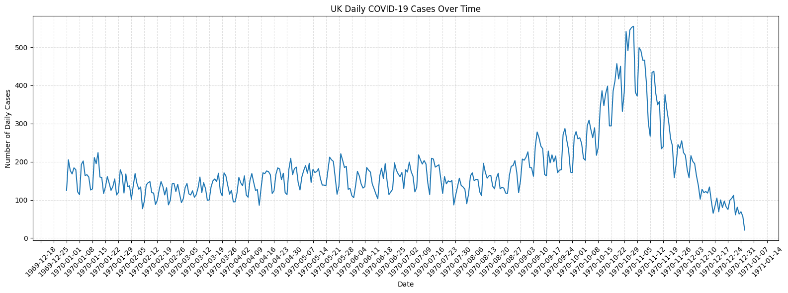

<p align="center">
  <a href="https://promevance.github.io"></a>
</p>

<h3 align="center">Data Analytics Portfolio · Product | Data | Finance | Business</h3>

<p align="center">
  <a href="https://promevance.github.io"></a>
  <a href="https://promevance.github.io/projects/"></a>
</p>

Hi, I'm **Evan Promise Chukwubueze**, an analyst and project manager with 5+ years of experience across finance, healthcare, real estate, FMCG and technology. This repository is the source of my portfolio site, **<https://promevance.github.io>**, and holds the data, code and documentation behind every project.

## Projects

Every project opens with a plain-language **"At a glance"** summary, followed by a technical **"Under the hood"** section.

| | Project | What it shows | Tools |
|---|---|---|---|
|  | **[Widening the Spotlight](projects/spotify-widening-the-spotlight/)**<br>A Tableau story and 10-year growth strategy for Spotify | 8% of artists earn 58% of hits, while Latin and K-pop grew from 0.6% to 14% of new hits. Dashboard, 26-page strategy deck, data, prep flow and a pandas check of the numbers | Tableau, Tableau Prep, Strategy |
|  | **[Mall Customer Segmentation](projects/mall-customer-segmentation/)**<br>K-Means clustering of 200 shoppers | Five customer segments and a marketing recommendation for each | Python, pandas, scikit-learn, seaborn |
|  | **[UK COVID-19 Daily Cases](projects/uk-covid19-daily-cases/)**<br>An interactive Python plot | A first end-to-end Python visualisation with hover tooltips | Python, pandas, Matplotlib |

## Repository map

```
.
├── index.html, about/, projects/index.html   ← portfolio pages
├── projects/
│   ├── spotify-widening-the-spotlight/       ← README, docs/, data/, tableau/, deck/, images/
│   ├── mall-customer-segmentation/           ← README, notebook, clustered CSV, images/
│   └── uk-covid19-daily-cases/               ← README (report), images/
├── assets/
│   ├── site.css, site.js                     ← design system and small helpers
│   └── brand/                                ← logo, favicon, pattern and social card
├── site-src/                                 ← templates and content the pages are generated from
├── 404.html, sitemap.xml, robots.txt
└── .nojekyll                                 ← the site is plain static HTML (no Jekyll build)
```

## How the site is built

The site is plain **HTML, CSS and a little JavaScript**, served by GitHub Pages with no build step on GitHub's side. The pages are generated from templates and Markdown in [`site-src/`](site-src/) so that headers, footers and project cards stay consistent. See [`site-src/README.md`](site-src/README.md) for how to add a project.

To preview locally:

```bash
python -m http.server 8000      # then open http://localhost:8000
```

## Design

The visual identity follows the Evan Promise brand kit: deep navy `#0F2847`, blue `#1B3F6B`, gold `#C9993A` / `#E0B86A` and ivory `#FAF8F4`, with Poppins and Inter for type. The site supports light and dark themes and is fully usable without JavaScript.

## Notes on data and trademarks

- The Spotify project uses a track dataset supplied for a university course. Spotify is a trademark of Spotify AB; the project is an independent academic case study and is not affiliated with or endorsed by Spotify.
- Earlier versions of the Mall Customer Segmentation and UK COVID-19 projects live in my [`dclc-python`](https://github.com/promevance/dclc-python) learning repository; this portfolio holds the polished versions.

## Contact

Email: [promevance@gmail.com](mailto:promevance@gmail.com) · GitHub: [@promevance](https://github.com/promevance)

---

Code and written content are released under the [CC0 1.0](LICENSE) licence, as in the original template. The logo and brand assets in `assets/brand/` are © Evan Promise, all rights reserved. Third-party data, logos and trademarks remain the property of their owners.
