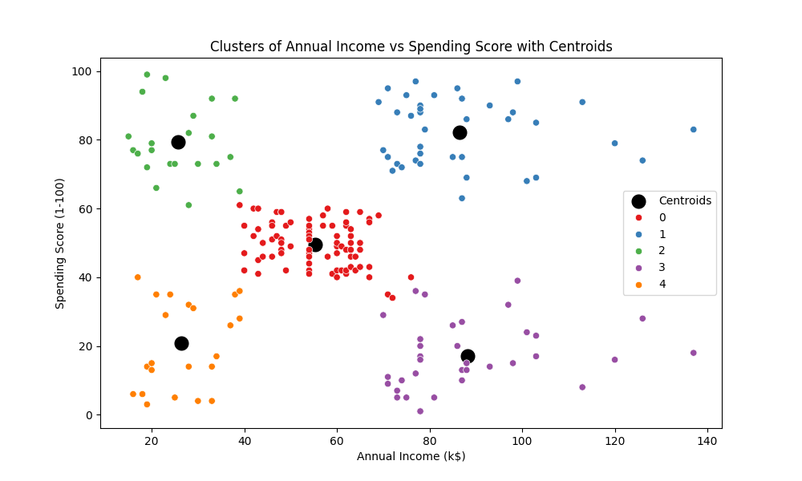
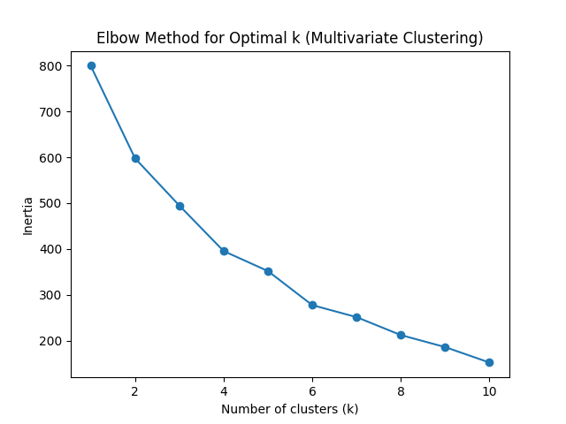

# Mall Customer Segmentation using K-Means Clustering

**Grouping 200 mall customers into five marketing segments by age, income and spending behaviour.**

[](https://promevance.github.io/projects/mall-customer-segmentation/)



## In one minute (non-technical summary)

The mall's management team wanted to know which customers matter most and how to split marketing spend. I grouped customers by how they actually spend, using K-Means clustering, and turned each group into a marketing recommendation.

| Segment | Customers | Avg. age | Avg. income (k$) | Avg. spending score | Reading |
|---|---|---|---|---|---|
| 1 | 39 | 33 | 87 | 82 | **Prime customers**: high income, high spending |
| 2 | 22 | 25 | 26 | 79 | **Enthusiastic spenders**: lower income, high spending |
| 0 | 81 | 43 | 55 | 50 | **Mainstream**: middle income, middle spending |
| 3 | 35 | 41 | 88 | 17 | **Untapped potential**: high income, low spending |
| 4 | 22 | 46 | 27 | 20 | **Low priority**: lower income, low spending |

*Segment numbers are the cluster labels in `mall_customers_clustered.csv`; the descriptive names are my interpretation. Averages are computed from that file.*

**Recommendations**

- **Prime customers:** the most valuable group. Prioritise premium offerings, loyalty programmes and exclusive promotions.
- **Enthusiastic spenders:** selective but intentional. Highlight trending products, promotions and value-for-money offers.
- **Everyone else:** less immediate revenue potential. Keep up brand awareness and social media marketing without heavy targeted spend, and test what would move the high-income, low-spending group.

## Problem statement

The mall management team wanted to:

- identify high-value customers;
- optimise marketing spend;
- design targeted campaigns for different customer segments; and
- enable customer-level analysis by the marketing team.

## Dataset

| Variable | Description |
|---|---|
| `Age` | Customer age |
| `Annual Income (k$)` | Annual income in thousands of dollars |
| `Spending Score (1-100)` | A metric representing customer spending behaviour at the mall |

The source dataset has 200 customer records. The exported file, `mall_customers_clustered.csv`, has 199 rows plus two added columns, `Cluster_Income_Spending` and `Cluster_Age_Spending`.

## Methodology

1. **Explore and clean**: loaded and inspected the data; checked missing values and consistency (univariate and bivariate analysis).
2. **Select features**: age, annual income and spending score.
3. **Choose the number of clusters**: elbow method, fitting K-Means for k = 1–10 and plotting inertia.
4. **Cluster**: K-Means with scikit-learn (`random_state=42`), three ways: income vs spending, age vs spending, and all three features.
5. **Visualise**: clusters with centroids using seaborn and matplotlib.



## What is in this folder

```
mall-customer-segmentation/
├── README.md
├── mall-cluster.ipynb              ← full workflow: exploration, elbow method, clustering, charts
├── mall_customers_clustered.csv    ← customer data with cluster labels
└── images/
    ├── clusters_with_centroids.png
    └── elbow_multivariate.png
```

## Tools

Python · Jupyter Notebook · pandas · scikit-learn · seaborn · matplotlib

## Limitations and next steps

- Two hundred customers demonstrates the method but is too small to size a campaign.
- The spending score is a given metric; without transactions, segments describe scored behaviour, not revenue.
- Segment names are my interpretation and should be validated with the marketing team.
- Next: scale features before multivariate clustering, compare with silhouette scores, and reconcile the 199 exported rows with the 200-customer source.

---

Part of the [Data Analytics portfolio](https://promevance.github.io/projects/) · [Back to the repository](../../README.md)
