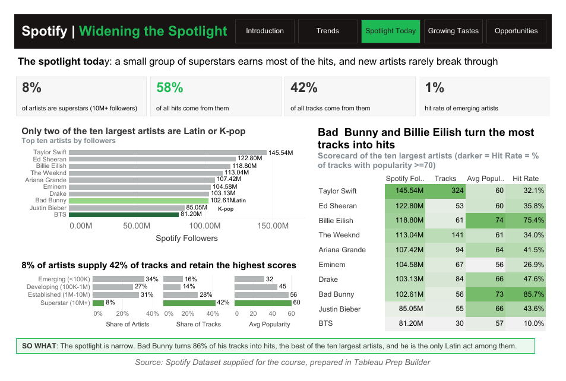
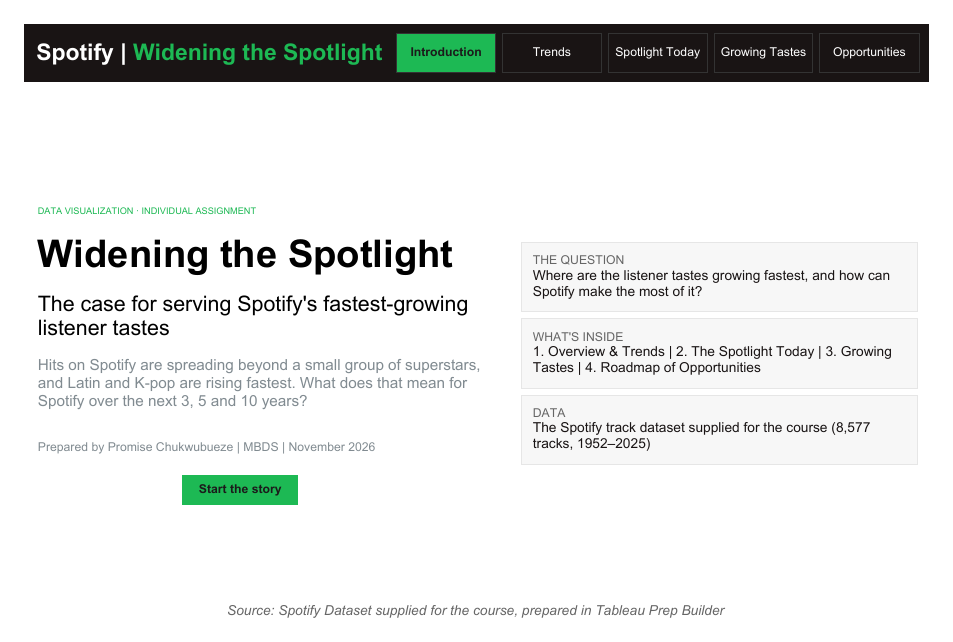
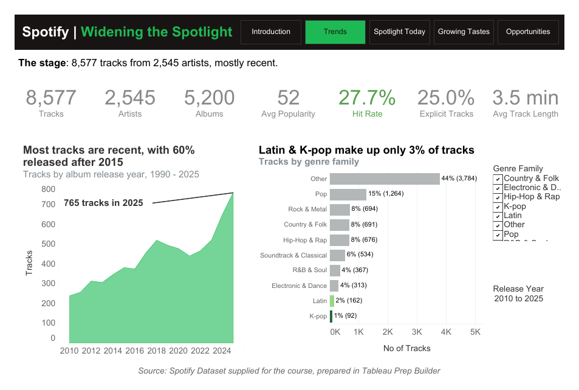
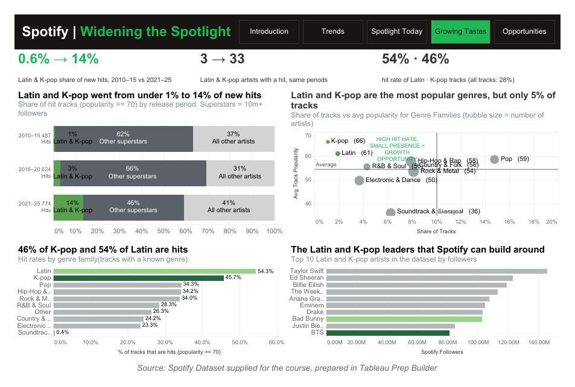
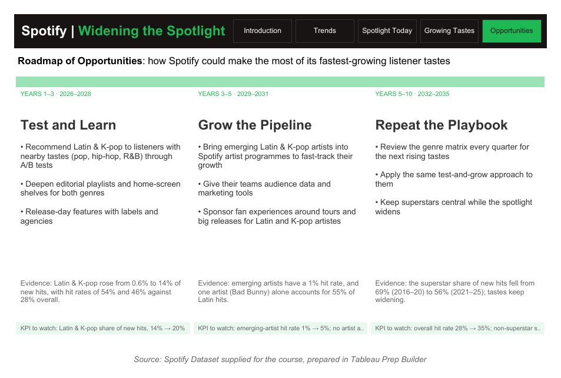

# Widening the Spotlight

**A Tableau story and 10-year growth strategy for Spotify, built from 8,577 tracks and 2,545 artists.**

[](https://public.tableau.com/app/profile/promise.chukwubueze/viz/SpotifyViz_17933813934110/Introduction)
[](https://promevance.github.io/projects/spotify-widening-the-spotlight/)



> Individual project for the Data Visualization course (MBDS), November 2026. Author: Evan Promise Chukwubueze (credited as Promise Chukwubueze on the deliverables).

## In one minute (non-technical summary)

Spotify decides which songs get heard. This project asks where it should point that attention over the next 3, 5 and 10 years.

| What the data shows | Why it matters |
|---|---|
| **58% of hits come from 202 superstar artists**, just 8% of all artists. Emerging artists (under 100K followers) turn only **1%** of their tracks into hits. | Success is concentrated, so Spotify depends on a handful of stars and the labels behind them. |
| **Latin and K-pop grew from 0.6% to 14% of new hits** (2010–15 vs 2021–25). | Listener taste is widening, with or without Spotify's help. |
| **Latin and K-pop hit rates are 54% and 46%**, against 28% for all tracks. | Their tracks are almost twice as likely to be hits. |

**Recommendation: widen the spotlight.** Keep the superstars central, but give the fastest-growing tastes the same discovery push, build a pipeline of artists inside them, and make the approach a repeatable habit.

| Horizon | Theme | KPI to watch |
|---|---|---|
| Years 1–3 (2026–28) | **Test and learn**: A/B-test Latin and K-pop recommendations with listeners of nearby tastes; deepen editorial playlists | Latin and K-pop share of new hits, 14% → 20% |
| Years 3–5 (2029–31) | **Grow the pipeline**: dedicated RADAR cohorts, audience data and marketing tools for artists | Emerging-artist hit rate, 1% → 5% |
| Years 5–10 (2032–35) | **Repeat the playbook**: quarterly genre radar to spot the next rising taste | Overall hit rate, 28% → 35% |

## The dashboard

A five-page Tableau story: **Introduction → Trends → The Spotlight Today → Growing Tastes → Opportunities.** See [`docs/dashboard-guide.md`](docs/dashboard-guide.md) for a page-by-page walkthrough, or open the [interactive version](https://public.tableau.com/app/profile/promise.chukwubueze/viz/SpotifyViz_17933813934110/Introduction).

| | |
|---|---|
|  |  |
|  |  |
|  | |

## What is in this folder

```
spotify-widening-the-spotlight/
├── README.md                      ← you are here
├── reproduce_key_figures.py       ← pandas script that re-derives the headline numbers
├── data/
│   ├── spotify_data_clean.csv     ← cleaned track data used in the analysis (8,582 rows)
│   └── track_data_final.csv       ← earlier extract, duration in milliseconds (8,778 rows)
├── tableau/
│   ├── Spotify_Viz.twb            ← Tableau workbook (ten worksheets)
│   └── Spotify_Prep_Flow.tflx     ← Tableau Prep flow that creates the analysis fields
├── deck/
│   ├── Widening_the_Spotlight_Strategic_Roadmap.pdf   ← 26-page strategy deck
│   └── Spotify_Viz_Dashboard.pdf                      ← dashboard export (5 pages)
├── docs/
│   ├── methodology.md             ← how the data was prepared and analysed
│   ├── data-dictionary.md         ← every column, original and derived
│   ├── insights.md                ← findings with the numbers behind them
│   ├── roadmap.md                 ← the 3, 5 and 10-year plan in detail
│   └── dashboard-guide.md         ← page-by-page guide to the Tableau story
└── images/                        ← previews used in the docs and on the portfolio site
```

## For analysts: reproduce the numbers

The dashboard is built in Tableau, but every headline figure can be re-derived with pandas.

```bash
pip install pandas
python reproduce_key_figures.py
```

The script mirrors the Tableau Prep field logic (artist tiers, genre families, hit definition) and prints the stage KPIs, hit share by artist tier, hit rate by genre family, share of hits by release period and the singles/track-length shift. It keeps 8,579 rows against the dashboard's 8,577, so figures can differ by about two rows; every percentage agrees to the rounding used in the dashboard.

## Opening the Tableau files

- **`Spotify_Viz.twb`** is a packaged-as-XML workbook that points to a local extract (`tracks_clean.hyper`) created by the Prep flow. To open it with live data, run the flow in Tableau Prep Builder first (input: `data/spotify_data_clean.csv`), then repoint the workbook's data source to the new extract. The published [Tableau Public version](https://public.tableau.com/app/profile/promise.chukwubueze/viz/SpotifyViz_17933813934110/Introduction) works without any setup.
- **`Spotify_Prep_Flow.tflx`** is a packaged flow. Open it in Tableau Prep Builder, and repoint the CSV input to `data/spotify_data_clean.csv` if prompted.

## Key definitions

- **Hit**: a track with a Spotify popularity score of 70 or more (out of 100). **Hit rate** is the share of tracks that are hits.
- **Artist tiers** (by Spotify followers): Emerging (<100K), Developing (100K–1M), Established (1M–10M), Superstar (10M+).
- **Genre families**: 400+ source genres grouped into 11 families by each artist's first listed genre. 39% of tracks have no genre and are excluded from genre comparisons.

## Limitations

- Popularity and hit rate measure listening, not revenue; the dataset contains no financials.
- The data is a sample of about 8,600 tracks, not Spotify's full catalogue.
- Popularity reflects recent plays, which favours newer tracks, so shares are compared within periods rather than as counts across periods.
- Roadmap targets are proposals for discussion.
- An AI assistant was used only to prepare and clean up the written strategy roadmap. The dashboard, idea and strategy are the author's own work.

## Sources and attribution

Track-level figures come from the Spotify track dataset supplied for the course. Industry and company context in the deck comes from public sources (Spotify results filings, IFPI, Music Business Worldwide, MIDiA Research, Hypebot, Korea Times), listed in the deck's appendix. Spotify is a trademark of Spotify AB; this is an independent academic case study, not affiliated with or endorsed by Spotify. Deck photographs are from Unsplash.

---

Part of the [Data Analytics portfolio](https://promevance.github.io/projects/) · [Back to the repository](../../README.md)
