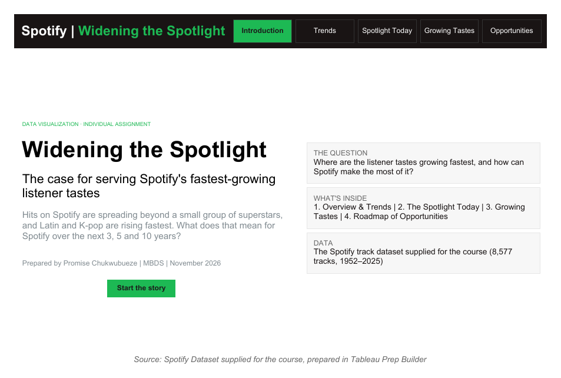
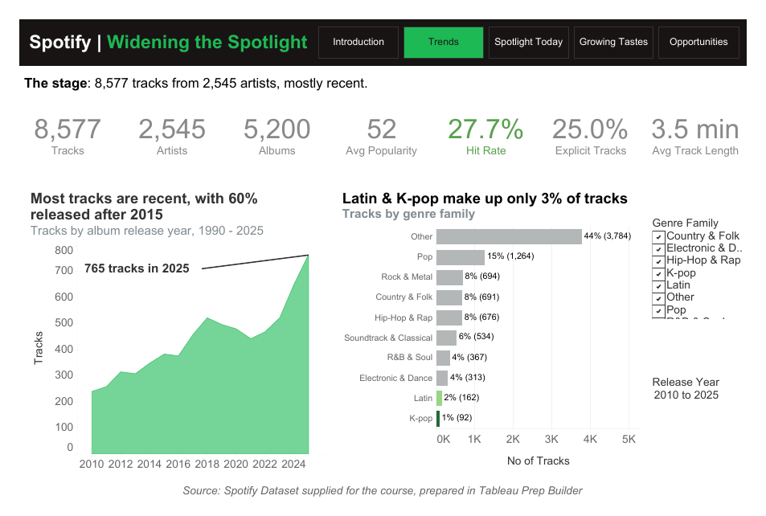
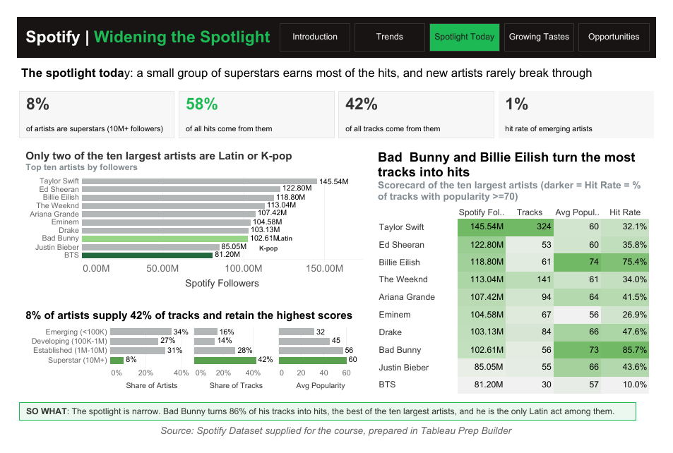
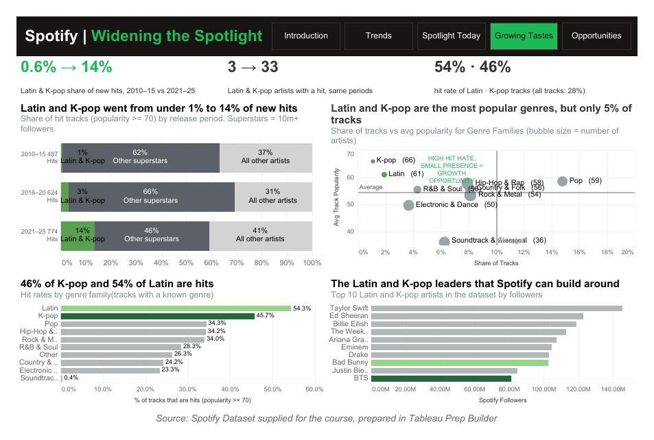
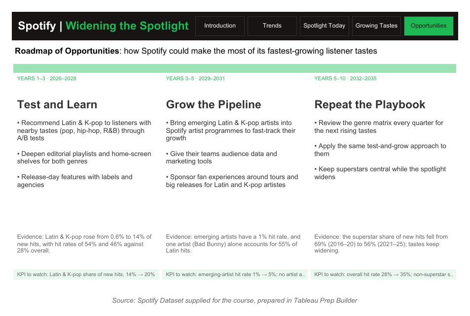

# Dashboard guide

The Tableau story has five pages, linked by a navigation bar at the top of each. Open the [interactive version on Tableau Public](https://public.tableau.com/app/profile/promise.chukwubueze/viz/SpotifyViz_17933813934110/Introduction), or see a printable copy in [`../deck/Spotify_Viz_Dashboard.pdf`](../deck/Spotify_Viz_Dashboard.pdf).

## 1. Introduction

The question ("Where are the listener tastes growing fastest, and how can Spotify make the most of it?"), what is inside, and the data used. A "Start the story" button leads to page 2.

## 2. Trends

A KPI strip (8,577 tracks, 2,545 artists, 5,200 albums, average popularity 52, hit rate 27.7%, 25.0% explicit, 3.5-minute average length), tracks by release year (60% released after 2015; 765 in 2025), and track counts by genre family (Latin 2% and K-pop 1% of tracks).

## 3. The Spotlight Today

*A small group of superstars earns most of the hits, and new artists rarely break through.* Four headline tiles (8% of artists are superstars; they earn 58% of hits and supply 42% of tracks; emerging artists have a 1% hit rate), a chart of the ten largest artists by followers, a scorecard of their tracks, average popularity and hit rate, and share of artists, tracks and average popularity by tier.

## 4. Growing Tastes

Latin and K-pop went from 0.6% to 14% of new hits; the number of artists with a hit grew from 3 to 33; hit rate by genre family (Latin 54%, K-pop 46% against 28% overall); a genre opportunity matrix of share of tracks against average popularity; and the top Latin and K-pop leaders by followers.

## 5. Opportunities

The roadmap of opportunities for 2026–2035: Test and Learn (years 1–3), Grow the Pipeline (years 3–5) and Repeat the Playbook (years 5–10), each with actions and a KPI to watch. Details in [`roadmap.md`](roadmap.md).

## Worksheets in the workbook

Artist Scorecard · Artist Tiers · Genre Mix · Genre Opportunity Matrix · Hit Rate by Genre · KPI Strip · Latin & K-pop Leaders · Releases by Year · Top Artists · Who Gets the Hits.
