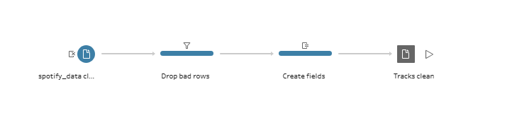

# Methodology

How "Widening the Spotlight" went from a raw track extract to a dashboard and a strategy.

## 1. Business framing

The brief asked for a strategic roadmap that gives an overview of Spotify's catalogue and largest players, shows performance KPIs, analyses how artists and genres compete for attention, deep-dives one component (**the fastest-growing listener tastes**), and recommends a business development and strategy roadmap for 3, 5 and 10 years.

The dataset has no revenue figures, so **popularity** and **hit rate** stand in for financial performance throughout.

## 2. Data

| | |
|---|---|
| Source | Spotify track dataset supplied for the course |
| Grain | One row per track |
| Raw extract | `data/track_data_final.csv`: 8,778 rows, 15 columns, track duration in milliseconds |
| Cleaned file | `data/spotify_data_clean.csv`: 8,582 rows, 15 columns, track duration in minutes |
| In the dashboard | **8,577 tracks, 2,545 artists, 5,200 albums**, released 1952–2025 |

The cleaned file replaces `track_duration_ms` with `track_duration_min` and holds 196 fewer rows than the raw extract. The Prep flow then removes rows with no artist name (step 3). Rebuilding the same logic in pandas leaves 8,579 rows against the dashboard's 8,577; I could not trace the remaining two-row difference from the files provided.

## 3. Preparation in Tableau Prep Builder (`tableau/Spotify_Prep_Flow.tflx`)



1. **Load CSV**: `spotify_data_clean.csv`.
2. **Drop bad rows**: remove rows with no artist name.
3. **Create fields**: six calculated fields (below).
4. **Write to Hyper extract**: `tracks_clean.hyper`, the data source behind the workbook.

The calculated fields:

```text
Release Year   = YEAR([album_release_date])
Content        = IF [explicit] THEN "Explicit" ELSE "Clean" END
Genres         = IF ISNULL([artist_genres]) THEN "Unknown"
                 ELSE TRIM(REPLACE([artist_genres], '"', "")) END
Primary Genre  = TRIM(SPLIT([Genres], ",", 1))
Artist Tier    = IF [artist_followers] >= 10000000 THEN "Superstar (10M+)"
                 ELSEIF [artist_followers] >= 1000000 THEN "Established (1M-10M)"
                 ELSEIF [artist_followers] >= 100000  THEN "Developing (100K-1M)"
                 ELSE "Emerging (<100K)" END
Genre Family   = keyword rules on Primary Genre (see below)
```

**Genre Family** groups 400+ source genres into 11 families. The first matching rule wins:

| Order | Family | Primary genre contains |
|---|---|---|
| 1 | Latin | latin, reggaeton, urbano, corrido, bachata, cumbia, salsa, dembow |
| 2 | K-pop | k-pop, k-rap |
| 3 | Hip-Hop & Rap | hip hop, rap, trap, drill, grime, phonk |
| 4 | R&B & Soul | r&b, soul |
| 5 | Rock & Metal | rock, metal, grunge, punk, emo |
| 6 | Country & Folk | country, folk |
| 7 | Soundtrack & Classical | soundtrack, anime, medieval, classical, children |
| 8 | Pop | pop |
| 9 | Electronic & Dance | edm, house, techno, electro, dance, dubstep |
| 10 | Other | everything else |
| – | Unknown | no genre in the source data (39% of tracks) |

## 4. Metric definitions

| Metric | Definition |
|---|---|
| **Hit** | A track with Spotify popularity of **70 or more** (out of 100) |
| **Hit rate** | Hits ÷ tracks, for any group of tracks |
| **Superstar / Established / Developing / Emerging** | Artist followers of 10M+ / 1M–10M / 100K–1M / under 100K |
| **Share of new hits** | Hits released in a period that belong to a group, ÷ all hits released in that period |
| **Periods** | 2010–15, 2016–20, 2021–25 (by album release year) |

Because popularity is based on recent plays and favours newer releases, the analysis compares **shares within each period** rather than raw counts across periods.

## 5. Analysis flow (the five-page story)

1. **Introduction**: the question, the answer and the data.
2. **Trends**: catalogue KPIs (tracks, artists, albums, average popularity, hit rate, explicit share, track length) and release patterns.
3. **The Spotlight Today**: who holds the hits (artist tiers) and the scorecard of the ten largest artists.
4. **Growing Tastes**: Latin and K-pop's share of new hits, hit rate by genre family, and a genre opportunity matrix (share of tracks vs average popularity).
5. **Opportunities**: the three-horizon roadmap.

Ten worksheets in `tableau/Spotify_Viz.twb` feed these pages: Artist Scorecard, Artist Tiers, Genre Mix, Genre Opportunity Matrix, Hit Rate by Genre, KPI Strip, Latin & K-pop Leaders, Releases by Year, Top Artists and Who Gets the Hits.

## 6. Validation

All headline numbers were re-derived independently in pandas (`reproduce_key_figures.py`) using the same field logic. The script keeps 8,579 rows against the dashboard's 8,577 and agrees on every percentage to the rounding used in the dashboard.

## 7. Strategy design

The roadmap uses four levers Spotify already controls (recommendations, editorial playlists, artist programmes, partnerships) across three horizons, each with a KPI and an evidence line from the data. External context (company results, industry growth by region, Latin and K-pop growth on Spotify) comes from public sources listed in the deck's appendix. See [`roadmap.md`](roadmap.md).

## 8. Limitations

- Popularity and hit rate measure listening, not revenue or profit.
- The dataset is a sample of about 8,600 tracks; shares describe this sample.
- 39% of tracks have no genre and are excluded from genre comparisons.
- Popularity favours recent tracks (see "Metric definitions").
- Targets are proposals for discussion, based on 2010–2025 trends in the data and Spotify's 2025 results.
