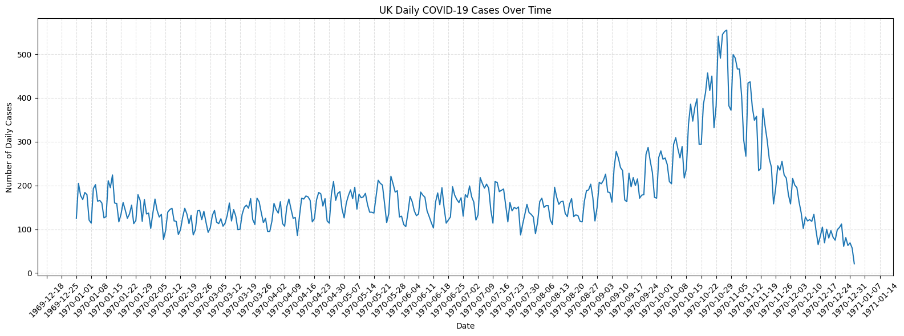

# UK COVID-19 Daily Cases: an interactive Python plot

**A line chart of UK daily COVID-19 cases with hover tooltips, built with pandas, Matplotlib and mplcursors.**

[](https://promevance.github.io/projects/uk-covid19-daily-cases/)



## In one minute (non-technical summary)

This was my first complete Python visualisation workflow. I loaded UK COVID-19 data, sorted it by date and plotted daily cases as a wide line chart. In the notebook, hovering over any point shows the exact date and number of cases.

## Introduction

This report explains the steps I took to generate a line plot showing UK daily COVID-19 cases, using Python in a Jupyter Notebook environment.

## Environment preparation

I wanted to use VS Code for this, as previously I had been using Jupyter Notebook from the web browser (through Anaconda). So I created the notebook in VS Code, linked it to the appropriate kernel, and installed the libraries needed for the modules I call.

## Data preparation

I downloaded the dataset and loaded it into a pandas DataFrame, which I sorted by date. I extracted two arrays, `x` for dates and `y` for daily case numbers, to make plotting easy.

## Plotting process

I used Matplotlib to generate the line plot. Key features:

- `figure.figsize = (16, 6)` for a wide layout;
- labels for the x-axis (Date), y-axis (Number of Daily Cases) and the title; and
- `mplcursors` to enable interactive hovering, so users can see the exact date and number of cases when moving the cursor over the plot.

## Code used

```python
%matplotlib inline
import matplotlib.pyplot as mplt
import mplcursors

mplt.plot(x, y)
mplt.xlabel('Date')
mplt.ylabel('Number of Daily Cases')
mplt.title('UK Daily COVID-19 Cases Over Time')

mplt.rcParams["figure.figsize"] = (16, 6)

cursor = mplcursors.cursor(hover=True)

mplt.show()
```

## Resulting plot


## Conclusion

The resulting plot provides a visual representation of COVID-19 case fluctuations over time, with an interactive feature that improves data exploration.

## What I would improve next

- Parse the date column with `pd.to_datetime` so the x-axis shows real calendar dates (in the exported image the date labels look like epoch-style values).
- Add a seven-day rolling average to make the trend easier to read.
- Add the data source and date range to the chart caption.

## Notes

The original notebook for this project was not included in the earlier repository (the file was empty), so this folder holds the written report and the chart only.

---

Part of the [Data Analytics portfolio](https://promevance.github.io/projects/) · [Back to the repository](../../README.md)
