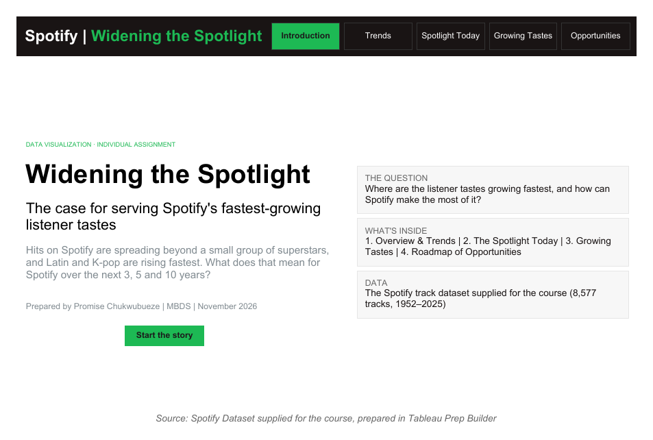
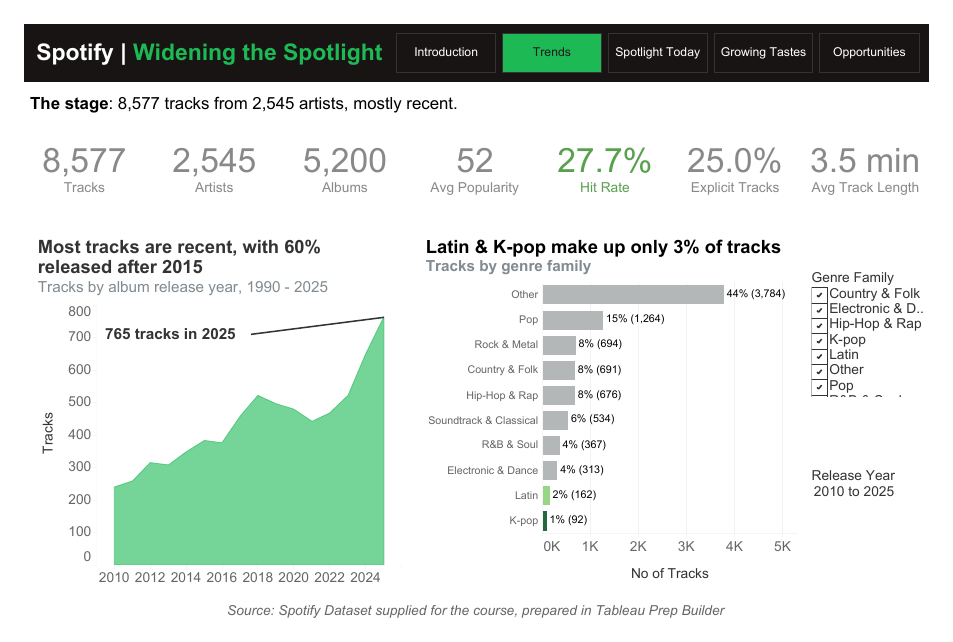
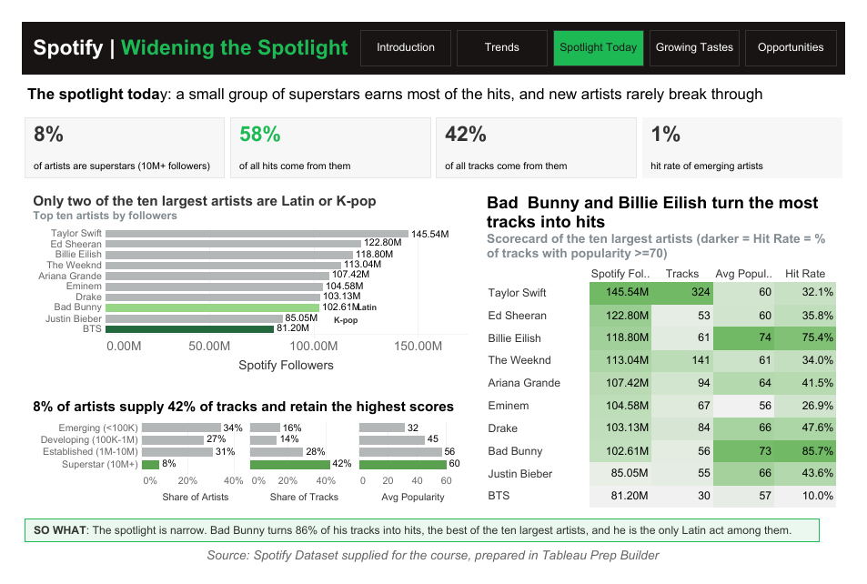
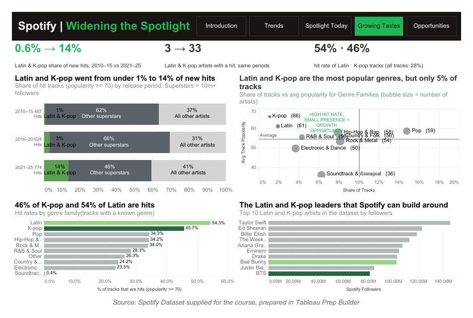
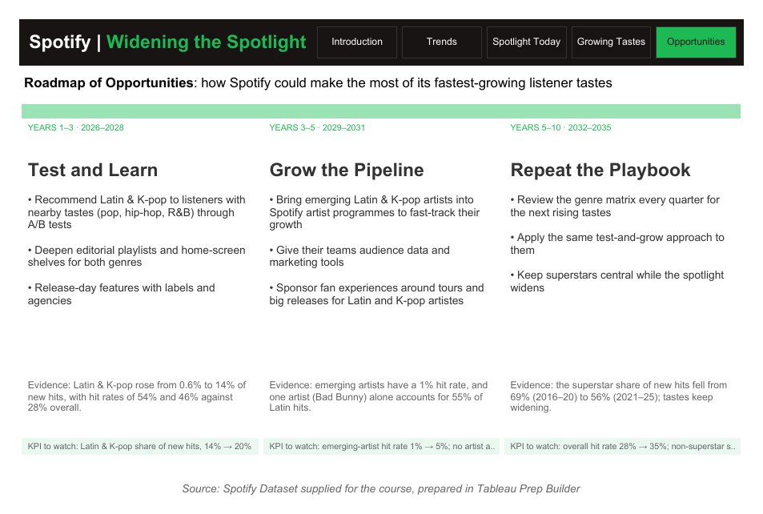
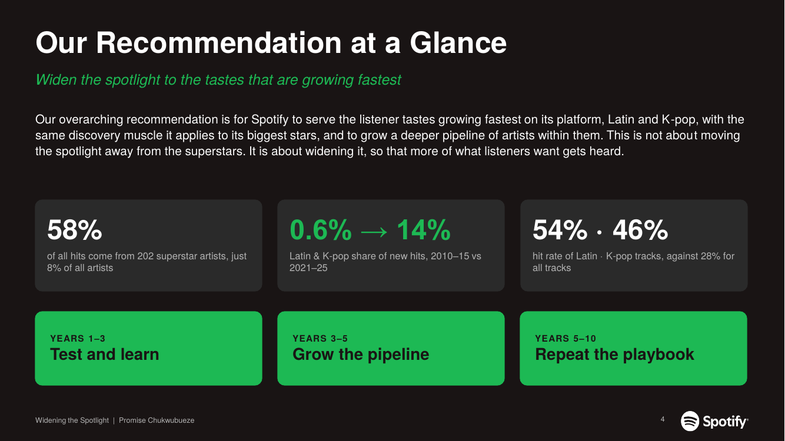
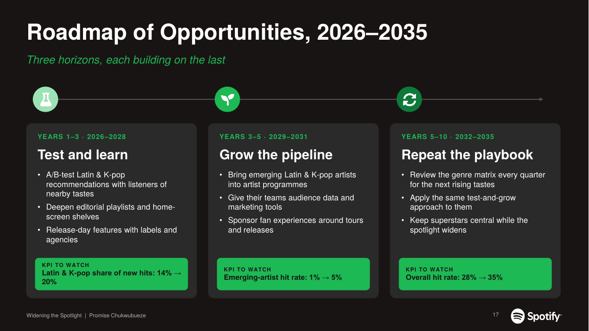
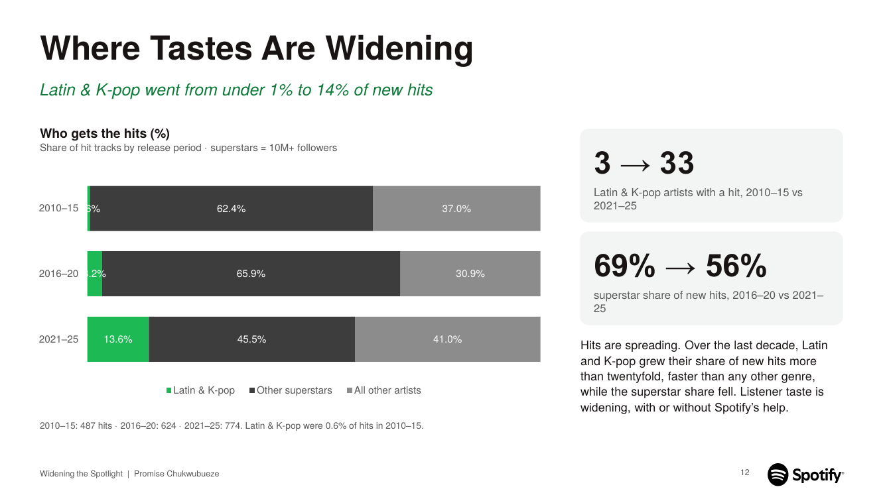
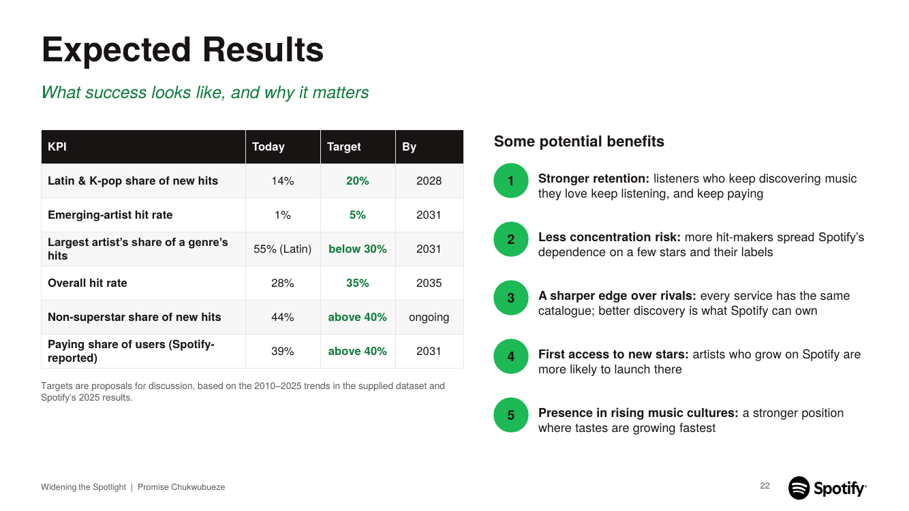
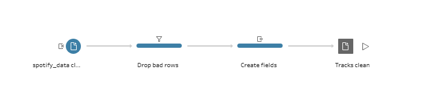

## At a glance {#at-a-glance}

<div class="callout navy">
<h3>The 60-second version</h3>
<ul>
<li><strong>The question.</strong> Spotify decides which songs get heard. Where should it point that attention to keep growing over the next 3, 5 and 10 years?</li>
<li><strong>What the data shows.</strong> Success is concentrated: 202 superstar artists (8% of all artists) produce 58% of the hits, and emerging artists turn only 1% of their tracks into hits. At the same time listeners are widening their taste. Latin and K-pop went from 0.6% to 14% of new hits, and their tracks are almost twice as likely to be hits as the average track.</li>
<li><strong>What I recommend.</strong> "Widen the spotlight": keep the superstars central, but give the fastest-growing tastes the same discovery push, grow a deeper pipeline of artists inside them, and turn the approach into a repeatable habit.</li>
</ul>
</div>

<div class="cols-3">
<div class="tile h"><h4>Years 1–3 · Test and learn</h4><p>A/B-test Latin and K-pop recommendations with listeners of nearby tastes. Deepen editorial playlists.</p></div>
<div class="tile h"><h4>Years 3–5 · Grow the pipeline</h4><p>Bring emerging Latin and K-pop artists into artist programmes, with audience data and marketing tools.</p></div>
<div class="tile h"><h4>Years 5–10 · Repeat the playbook</h4><p>Review the genre opportunity matrix every quarter to spot the next rising taste early.</p></div>
</div>

<div class="callout soft">
<h3>Who this is for</h3>
<p><strong>Hiring managers and non-technical readers:</strong> this section, the findings and the recommendations tell the whole story. <strong>Analysts and data leads:</strong> jump to <a href="#under-the-hood">Under the hood</a> for the data preparation, definitions, validation and files.</p>
</div>

## The business question {#business-question}

The assignment brief asked for a strategic roadmap that would:

- give an overview of Spotify's catalogue, its largest players and the trends shaping it;
- showcase performance KPIs (popularity and hit rate stand in for financials, which the dataset does not contain);
- analyse how artists and genres compete for listeners' attention;
- take a deep dive into one component, **Spotify's fastest-growing listener tastes**; and
- recommend a business development and strategy roadmap for the next 3, 5 and 10 years.

I framed the answer around one idea: on Spotify, the **spotlight** is the attention that recommendations, playlists and home-screen placement give to a song. Today it falls mostly on a few superstars. The data shows listeners already reaching beyond them, so the opportunity is not to move the spotlight away from the stars but to **widen** it.

## The dashboard {#dashboard}

The analysis is a five-page Tableau story that walks the reader from the big picture to the recommendation. Click any page to enlarge it, or <a href="https://public.tableau.com/app/profile/promise.chukwubueze/viz/SpotifyViz_17933813934110/Introduction" target="_blank" rel="noopener">open the interactive version on Tableau Public</a>.

<div class="gallery">
<figure class="zoomable"><figcaption><strong>1 · Introduction.</strong> The question and the answer up front.</figcaption></figure>
<figure class="zoomable"><figcaption><strong>2 · Trends.</strong> Catalogue KPIs and how releases have changed.</figcaption></figure>
<figure class="zoomable"><figcaption><strong>3 · The spotlight today.</strong> Who earns the hits, and who does not.</figcaption></figure>
<figure class="zoomable"><figcaption><strong>4 · Growing tastes.</strong> Latin and K-pop rise; hit rate by genre.</figcaption></figure>
</div>
<figure class="zoomable"><figcaption><strong>5 · Opportunities.</strong> The three-horizon roadmap with the KPI to watch in each.</figcaption></figure>

## What the data says {#findings}

### 1. The catalogue is recent, and releases are getting shorter and more frequent

Sixty percent of the 8,577 tracks were released after 2015, and 765 are from 2025. **Singles went from 7% of releases in 2010 to 58% in 2025**, and the average song got about 50 seconds shorter (3.9 to 3.1 minutes). In a singles-led world listeners rely on playlists and recommendations to find new music, so the discovery engine Spotify controls now does much of the work that albums and radio once did.

### 2. The spotlight is narrow

<div class="chart">
<h4>Superstars hold 8% of artists but earn 58% of hits</h4>
<p class="sub">Share of artists, tracks and hits by artist tier (tier set by Spotify followers; hit = popularity of 70 or more)</p>
<div class="bars">
<div class="bar hi"><span class="l">Superstar (10M+)</span><span class="t"><i style="width:57.6%"></i></span><span class="v">58%</span></div>
<div class="bar"><span class="l">Established (1–10M)</span><span class="t"><i style="width:34.6%"></i></span><span class="v">35%</span></div>
<div class="bar"><span class="l">Developing (100K–1M)</span><span class="t"><i style="width:7.3%"></i></span><span class="v">7%</span></div>
<div class="bar"><span class="l">Emerging (&lt;100K)</span><span class="t"><i style="width:0.5%"></i></span><span class="v">0.5%</span></div>
</div>
<p class="sub" style="margin:14px 0 0">Bars show each tier's share of all hits. Superstars are 8% of artists and 42% of tracks. Emerging artists are 34% of artists but turn only 1% of their tracks into hits.</p>
</div>

Followers do not guarantee hits. Taylor Swift has the most followers (146M) and the most tracks (324) in the data, yet converts 32% of them into hits. **Bad Bunny converts 86%** and Billie Eilish 75%. BTS, the only K-pop act among the ten largest artists, has the lowest hit rate of the group (10%), a sign that K-pop's strength now lies in a broader set of artists.

This is a business risk as well as a data point: when a handful of stars supply most of the hits, the labels behind them hold strong bargaining power, and rival services stream the same stars.

### 3. Listener tastes are widening, with or without Spotify's help

<div class="chart">
<h4>Latin and K-pop went from under 1% to 14% of new hits</h4>
<p class="sub">Share of hit tracks by release period (2010–15: 487 hits · 2016–20: 624 · 2021–25: 774)</p>
<div class="stack">
<div class="srow"><span class="l">2010–15</span><span class="t"><i class="a" style="width:0.6%"></i><i class="b" style="width:62.4%"></i><i class="c" style="width:37%"></i></span></div>
<div class="srow-nums">Latin and K-pop 0.6% · other superstars 62.4% · all other artists 37.0%</div>
<div class="srow"><span class="l">2016–20</span><span class="t"><i class="a" style="width:3.2%"></i><i class="b" style="width:65.9%"></i><i class="c" style="width:30.9%"></i></span></div>
<div class="srow-nums">Latin and K-pop 3.2% · other superstars 65.9% · all other artists 30.9%</div>
<div class="srow"><span class="l">2021–25</span><span class="t"><i class="a" style="width:13.6%"></i><i class="b" style="width:45.5%"></i><i class="c" style="width:41%"></i></span></div>
<div class="srow-nums">Latin and K-pop 13.6% · other superstars 45.5% · all other artists 41.0%</div>
</div>
<div class="legend"><span style="--c:var(--gold)">Latin and K-pop</span><span style="--c:var(--blue)">Other superstars (10M+ followers)</span><span style="--c:#A9B7CC">All other artists</span></div>
</div>

The number of Latin and K-pop artists with a hit grew from **3 to 33** between 2010–15 and 2021–25, while the superstar share of new hits fell from 69% (2016–20) to 56% (2021–25). Industry data points the same way: Latin America was the world's fastest-growing recorded-music region in 2025 (+17.1%, IFPI), and Bad Bunny was Spotify's most-streamed artist of 2025.

### 4. Latin and K-pop tracks are almost twice as likely to be hits

<div class="chart">
<h4>Hit rate by genre family</h4>
<p class="sub">Share of tracks with a popularity score of 70 or more. 39% of tracks have no genre in the source data and are left out.</p>
<div class="bars">
<div class="bar hi"><span class="l">Latin</span><span class="t"><i style="width:54%"></i></span><span class="v">54%</span></div>
<div class="bar hi"><span class="l">K-pop</span><span class="t"><i style="width:46%"></i></span><span class="v">46%</span></div>
<div class="bar"><span class="l">Pop</span><span class="t"><i style="width:34%"></i></span><span class="v">34%</span></div>
<div class="bar"><span class="l">Hip-Hop &amp; Rap</span><span class="t"><i style="width:34%"></i></span><span class="v">34%</span></div>
<div class="bar"><span class="l">Rock &amp; Metal</span><span class="t"><i style="width:34%"></i></span><span class="v">34%</span></div>
<div class="bar"><span class="l">R&amp;B &amp; Soul</span><span class="t"><i style="width:28%"></i></span><span class="v">28%</span></div>
<div class="bar"><span class="l">Country &amp; Folk</span><span class="t"><i style="width:24%"></i></span><span class="v">24%</span></div>
<div class="bar"><span class="l">Electronic &amp; Dance</span><span class="t"><i style="width:23%"></i></span><span class="v">23%</span></div>
<div class="bar ref"><span class="l">All tracks</span><span class="t"><i style="width:28%"></i></span><span class="v">28%</span></div>
</div>
</div>

**A note of caution.** Latin still leans on one star: Bad Bunny accounts for 55% of Latin hits, and without him the Latin hit rate falls from 54% to 38% (still above the 28% average). K-pop is broader: without BTS its hit rate rises to 63%. That is why the recommendation includes building a pipeline of artists, not just promoting the genre.

## Recommendations {#recommendations}

The overarching recommendation is for Spotify to serve the tastes growing fastest on its platform with the same discovery muscle it applies to its biggest stars. It uses four levers Spotify already controls: **recommendations, editorial playlists, artist programmes and partnerships.**

<div class="timeline">
<div class="horizon"><div class="when"><small>Years 1–3 · 2026–28</small><b>Test and learn</b></div><div class="what"><h4>Serve rising tastes where listeners are most likely to love them</h4><p>A/B-test Latin and K-pop recommendations with listeners of adjacent tastes (pop, hip-hop, R&amp;B) and expand only where saves and replays rise. Deepen editorial playlists and home-screen shelves. Work with labels on release-day features.</p><span class="kpi-pill">KPI: Latin and K-pop share of new hits, 14% → 20%</span></div></div>
<div class="horizon"><div class="when"><small>Years 3–5 · 2029–31</small><b>Grow the pipeline</b></div><div class="what"><h4>Turn more new artists into the next generation of stars</h4><p>Create dedicated Latin and K-pop cohorts in the RADAR emerging-artist programme, give artists audience data and marketing tools, and sponsor fan experiences around tours and releases.</p><span class="kpi-pill">KPI: emerging-artist hit rate, 1% → 5%; no artist above 30% of a genre's hits</span></div></div>
<div class="horizon"><div class="when"><small>Years 5–10 · 2032–35</small><b>Repeat the playbook</b></div><div class="what"><h4>Make widening the spotlight a habit, not a one-off</h4><p>Review the genre opportunity matrix quarterly to find tastes with a high hit rate and a small presence, then apply the same test-and-grow approach. Keep the superstars central while the spotlight widens.</p><span class="kpi-pill">KPI: overall hit rate, 28% → 35%; non-superstar share of hits above 40%</span></div></div>
</div>

The full deck adds an implementation plan (which Spotify team leads each initiative, with timeline and KPI), expected results, and a risk register covering listener fatigue, dependence on one star, cultural authenticity and measuring the wrong thing.

<div class="gallery">
<figure class="zoomable"><figcaption>Strategy deck: recommendation at a glance.</figcaption></figure>
<figure class="zoomable"><figcaption>Strategy deck: three horizons, 2026–2035.</figcaption></figure>
<figure class="zoomable"><figcaption>Strategy deck: where tastes are widening.</figcaption></figure>
<figure class="zoomable"><figcaption>Strategy deck: expected results and KPI targets.</figcaption></figure>
</div>

## Under the hood {#under-the-hood}

### Data

The dataset is a Spotify track extract supplied for the course: one row per track, with track, artist and album attributes (popularity, followers, genres, release date, duration, explicit flag). The extract held 8,778 rows; the cleaned file used for analysis has 8,582 rows, and the dashboard reports **8,577 tracks from 2,545 artists on 5,200 albums, released between 1952 and 2025**. Business and industry context in the strategy deck comes from public sources (Spotify results filings, IFPI, Music Business Worldwide and others), which are listed in the deck's appendix.

### Preparation in Tableau Prep Builder

A four-step flow loads the cleaned CSV, drops rows with no artist, and creates six fields that drive every chart:

<figure class="zoomable"><figcaption>The Tableau Prep flow behind the dashboard.</figcaption></figure>

| Field | Logic |
|---|---|
| Release Year | Year taken from the album release date |
| Content | "Explicit" or "Clean", from the explicit flag |
| Genres | Source genre list; blank values become "Unknown" |
| Primary Genre | The first genre listed for the artist |
| Artist Tier | Superstar (10M+ followers), Established (1M–10M), Developing (100K–1M), Emerging (under 100K) |
| Genre Family | 400+ source genres grouped into 11 families by keyword rules (Latin, K-pop, Hip-Hop & Rap, Pop, and so on) |

### Definitions that matter

- **Hit:** a track with a Spotify popularity score of 70 or more (out of 100). **Hit rate** is the share of tracks that are hits.
- **Share comparisons are made within each period**, not as counts across periods, because popularity reflects recent plays and favours newer tracks.
- **Genre analysis covers tracks with a known genre.** 39% of tracks have no genre in the source data.

### Independent check of the numbers

To make sure the dashboard figures were right, I rebuilt the same field logic in pandas and re-derived the headline results: 8% of artists and 58% of hits for superstars, 54% and 46% hit rates for Latin and K-pop, and 0.6% to 13.6% of new hits. They agree with the dashboard to the rounding used (the script keeps 8,579 rows against the dashboard's 8,577, a difference of two rows). The script is in the repository.

```python
def artist_tier(followers):
    if followers >= 10_000_000: return "Superstar (10M+)"
    if followers >= 1_000_000:  return "Established (1M-10M)"
    if followers >= 100_000:    return "Developing (100K-1M)"
    return "Emerging (<100K)"

tier = df.groupby("Artist Tier").agg(tracks=("Hit", "size"), hits=("Hit", "sum"), hit_rate=("Hit", "mean"))
tier["share_of_hits"] = tier["hits"] / tier["hits"].sum()
```

## Limitations {#limitations}

- **Popularity and hit rate measure listening, not revenue.** The story shows where to invest; it does not prove profit. The roadmap proposes confirming results with Spotify's own data on saves, replays, retention and subscriptions.
- **The dataset is a sample of about 8,600 tracks**, not the full catalogue, so shares describe this sample.
- **Popularity favours recent tracks**, which is why comparisons are made within periods.
- **Targets in the roadmap are proposals for discussion**, based on 2010–2025 trends in the dataset and Spotify's 2025 results.
- **AI use, for transparency:** an AI assistant was used only to prepare and clean up the written strategy roadmap. The dashboard, the idea and the strategy are my own work.

## Files and documentation {#files}

Everything below lives in the <a href="https://github.com/promevance/promevance.github.io/tree/main/projects/spotify-widening-the-spotlight" target="_blank" rel="noopener">project folder on GitHub</a>.

<div class="files">
<a class="file" href="/projects/spotify-widening-the-spotlight/deck/Widening_the_Spotlight_Strategic_Roadmap.pdf"><span class="ext">PDF</span><span><b>Strategy deck: Widening the Spotlight</b><span class="d">26-page roadmap with evidence, implementation plan, risks and sources.</span></span><span class="go">Open ↗</span></a>
<a class="file" href="/projects/spotify-widening-the-spotlight/deck/Spotify_Viz_Dashboard.pdf"><span class="ext">PDF</span><span><b>Dashboard export</b><span class="d">All five Tableau pages as a printable PDF.</span></span><span class="go">Open ↗</span></a>
<a class="file" href="https://github.com/promevance/promevance.github.io/blob/main/projects/spotify-widening-the-spotlight/README.md" target="_blank" rel="noopener"><span class="ext">MD</span><span><b>Project README</b><span class="d">Overview, repository map and how to reproduce the figures.</span></span><span class="go">GitHub ↗</span></a>
<a class="file" href="https://github.com/promevance/promevance.github.io/tree/main/projects/spotify-widening-the-spotlight/docs" target="_blank" rel="noopener"><span class="ext">MD</span><span><b>Documentation</b><span class="d">Methodology, data dictionary, insights and roadmap write-ups.</span></span><span class="go">GitHub ↗</span></a>
<a class="file" href="/projects/spotify-widening-the-spotlight/data/spotify_data_clean.csv"><span class="ext">CSV</span><span><b>spotify_data_clean.csv</b><span class="d">Cleaned track data used in the analysis (8,582 rows, 15 columns).</span></span><span class="go">Download</span></a>
<a class="file" href="/projects/spotify-widening-the-spotlight/data/track_data_final.csv"><span class="ext">CSV</span><span><b>track_data_final.csv</b><span class="d">Earlier extract with duration in milliseconds (8,778 rows).</span></span><span class="go">Download</span></a>
<a class="file" href="/projects/spotify-widening-the-spotlight/tableau/Spotify_Viz.twb"><span class="ext">TWB</span><span><b>Spotify_Viz.twb</b><span class="d">Tableau workbook with the ten worksheets behind the story.</span></span><span class="go">Download</span></a>
<a class="file" href="/projects/spotify-widening-the-spotlight/tableau/Spotify_Prep_Flow.tflx"><span class="ext">TFLX</span><span><b>Spotify_Prep_Flow.tflx</b><span class="d">Tableau Prep flow that creates the analysis fields.</span></span><span class="go">Download</span></a>
<a class="file" href="https://github.com/promevance/promevance.github.io/blob/main/projects/spotify-widening-the-spotlight/reproduce_key_figures.py" target="_blank" rel="noopener"><span class="ext">PY</span><span><b>reproduce_key_figures.py</b><span class="d">pandas script that re-derives the headline numbers.</span></span><span class="go">GitHub ↗</span></a>
</div>

## Skills demonstrated {#skills}

<div class="chips">
<span class="chip">Data storytelling</span><span class="chip">Tableau dashboard design</span><span class="chip">Tableau Prep</span><span class="chip">Calculated fields</span><span class="chip">Business strategy and roadmapping</span><span class="chip">KPI design</span><span class="chip">pandas validation</span><span class="chip">Documentation</span>
</div>
