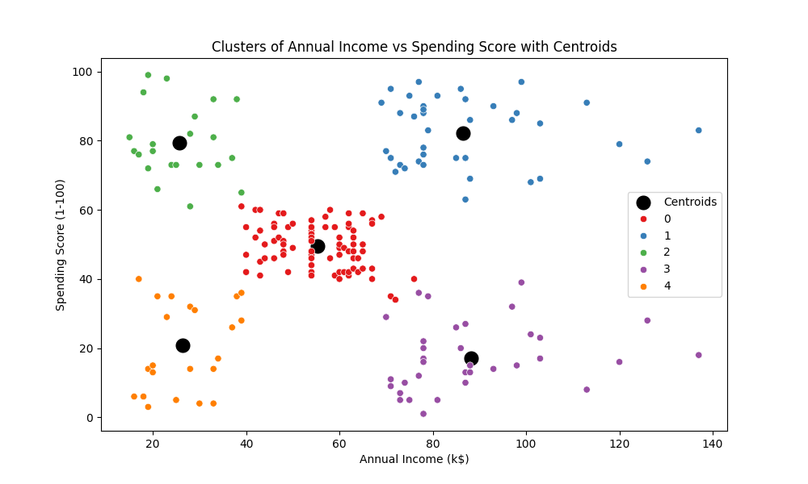
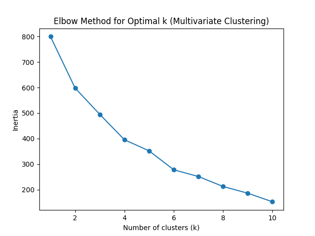

## At a glance {#at-a-glance}

<div class="callout navy">
<h3>The 60-second version</h3>
<ul>
<li><strong>The question.</strong> Which customers are worth the most to the mall, and how should marketing spend be split between them?</li>
<li><strong>What I did.</strong> Grouped 200 customers into five segments with K-Means clustering, using age, annual income and a 1–100 spending score.</li>
<li><strong>What I found.</strong> One group stands out: high-income, high-spending customers (about 39 shoppers, mostly in their early 30s). Another group spends a lot on lower incomes. A third has high income but spends very little, which is untapped potential.</li>
<li><strong>What I recommend.</strong> Put premium offers and loyalty programmes behind the prime group, run trend and value-for-money campaigns for the high spenders on lower incomes, and keep light-touch brand awareness for the rest.</li>
</ul>
</div>

## The business question {#business-question}

The mall's management team wanted to understand its customer base in order to:

- identify high-value customers;
- optimise marketing spend;
- design targeted campaigns for different customer segments; and
- let the marketing team drill down to individual customers.

Rather than treating all customers the same, clustering lets the business make decisions based on how people actually spend.

## What I found {#findings}

<figure class="zoomable"><figcaption>Five customer segments by annual income and spending score. Black dots are the cluster centres.</figcaption></figure>

| Segment | Customers | Avg. age | Avg. income (k$) | Avg. spending score | How I read it |
|---|---|---|---|---|---|
| 1 | 39 | 33 | 87 | 82 | **Prime customers.** High income, high spending |
| 2 | 22 | 25 | 26 | 79 | **Enthusiastic spenders.** Lower income, high spending |
| 0 | 81 | 43 | 55 | 50 | **Mainstream.** Middle income, middle spending |
| 3 | 35 | 41 | 88 | 17 | **Untapped potential.** High income, low spending |
| 4 | 22 | 46 | 27 | 20 | **Low priority.** Lower income, low spending |

<p class="sub" style="color:var(--muted);font-size:.86rem">Segment numbers are the cluster labels in the exported CSV; the descriptive names are mine. Averages are computed from that file.</p>

### Recommendations by segment

<div class="cols-3">
<div class="tile h"><h4>Prime customers</h4><p>The most valuable group. Prioritise premium offerings, loyalty programmes and exclusive promotions.</p></div>
<div class="tile h"><h4>Enthusiastic spenders</h4><p>Selective but intentional. Highlight trending products, promotions and value-for-money offers.</p></div>
<div class="tile h"><h4>Everyone else</h4><p>Less immediate revenue potential. Keep up brand awareness and social media marketing without heavy targeted spend. Test what would move the high-income, low-spending group.</p></div>
</div>

## Under the hood {#under-the-hood}

### Method

1. **Explore and clean.** Loaded and inspected the data, checked for missing values and consistency (univariate and bivariate analysis).
2. **Select features.** Age, annual income and spending score.
3. **Choose the number of clusters.** Used the **elbow method**: fit K-Means for k = 1 to 10 and plot the inertia (within-cluster sum of squares), then look for the bend.
4. **Cluster.** K-Means from scikit-learn with `random_state=42` for reproducibility. I clustered three ways: income vs spending, age vs spending, and all three features together.
5. **Visualise.** Plotted clusters with their centroids with seaborn and matplotlib.

<figure class="zoomable"><figcaption>Elbow plot for the multivariate clustering: inertia falls steeply until about four to six clusters, then flattens.</figcaption></figure>

```python
# Inertia for different values of k (multivariate clustering)
inertia_values3 = []

for k in range(1, 11):
    kmeans = KMeans(n_clusters=k, random_state=42)
    kmeans.fit(df3)
    inertia_values3.append(kmeans.inertia_)

plt.plot(range(1, 11), inertia_values3, marker='o')
plt.title('Elbow Method for Optimal k (Multivariate Clustering)')
plt.xlabel('Number of clusters (k)')
plt.ylabel('Inertia')
plt.savefig('elbow_multivariate.png')
plt.show()
```

```python
# Plot clusters with centroids
plt.figure(figsize=(10, 6))

sns.scatterplot(data=centres, x='Annual Income (k$)', y='Spending Score (1-100)',
                s=200, color='black', label='Centroids')

sns.scatterplot(data=df2, x='Annual Income (k$)', y='Spending Score (1-100)',
                hue='Cluster_Income_Spending', palette='Set1')

plt.title('Clusters of Annual Income vs Spending Score with Centroids')
plt.xlabel('Annual Income (k$)')
plt.ylabel('Spending Score (1-100)')
plt.legend()
plt.savefig('clusters_with_centroids.png')
plt.show()
```

### Dataset

The data has three behavioural variables: **Age**, **Annual Income (k$)** and **Spending Score (1–100)**, a metric representing customer spending behaviour at the mall. The exported file adds two columns, `Cluster_Income_Spending` and `Cluster_Age_Spending`, so the marketing team can filter to any segment.

## Limitations and next steps {#limitations}

- **Small dataset.** Two hundred customers is enough to demonstrate the method but not to size a campaign.
- **The spending score is a given metric.** I did not have the underlying transactions, so the segments describe behaviour as scored, not revenue.
- **Cluster labels are not business labels.** The names above are my interpretation and should be validated with the marketing team.
- **Next:** scale the features before multivariate clustering, compare with silhouette scores, and reconcile the 199 rows in the exported CSV with the 200 customers in the source dataset.

## Files {#files}

<div class="files">
<a class="file" href="https://github.com/promevance/promevance.github.io/blob/main/projects/mall-customer-segmentation/mall-cluster.ipynb" target="_blank" rel="noopener"><span class="ext">IPYNB</span><span><b>mall-cluster.ipynb</b><span class="d">Full workflow: exploration, elbow method, clustering and charts.</span></span><span class="go">GitHub ↗</span></a>
<a class="file" href="/projects/mall-customer-segmentation/mall_customers_clustered.csv"><span class="ext">CSV</span><span><b>mall_customers_clustered.csv</b><span class="d">Customer data with cluster labels added.</span></span><span class="go">Download</span></a>
<a class="file" href="/projects/mall-customer-segmentation/images/clusters_with_centroids.png"><span class="ext">PNG</span><span><b>clusters_with_centroids.png</b><span class="d">Cluster visual with centroids.</span></span><span class="go">Open ↗</span></a>
<a class="file" href="https://github.com/promevance/promevance.github.io/blob/main/projects/mall-customer-segmentation/README.md" target="_blank" rel="noopener"><span class="ext">MD</span><span><b>Project README</b><span class="d">Overview and repository map.</span></span><span class="go">GitHub ↗</span></a>
</div>

## Skills demonstrated {#skills}

<div class="chips">
<span class="chip">Unsupervised learning</span><span class="chip">K-Means clustering</span><span class="chip">Elbow method</span><span class="chip">pandas</span><span class="chip">scikit-learn</span><span class="chip">seaborn and matplotlib</span><span class="chip">Customer segmentation</span><span class="chip">Turning models into marketing actions</span>
</div>
