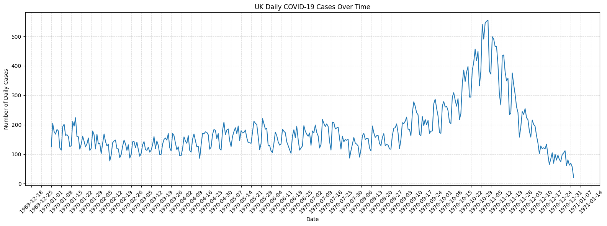

## At a glance {#at-a-glance}

<div class="callout navy">
<h3>The 60-second version</h3>
<ul>
<li><strong>The question.</strong> How did daily COVID-19 cases in the UK change over time, and can a reader explore the exact numbers?</li>
<li><strong>What I did.</strong> Loaded the UK data into pandas, sorted it by date and plotted daily cases as a wide line chart, with interactive tooltips so a reader can hover over any point and see the date and case count.</li>
<li><strong>Why it matters.</strong> This was my first complete Python visualisation workflow: set up the environment, prepare the data, plot, and document the result. The same habits carry into the larger projects on this site.</li>
</ul>
</div>

## The result {#result}

<figure class="zoomable"><figcaption>UK daily COVID-19 cases over time. In the live notebook the chart is interactive: hovering shows the exact date and number of cases.</figcaption></figure>

The resulting plot gives a visual representation of how case numbers fluctuated over time, and the hover interaction makes it easy to explore specific days.

## Under the hood {#under-the-hood}

### Environment

I wanted to work in VS Code, having previously used Jupyter Notebook in the browser through Anaconda. So I created the notebook in VS Code, linked it to the right Python kernel, and installed the libraries the notebook imports.

### Data preparation

I downloaded the dataset and loaded it into a pandas DataFrame, which I sorted by date. I then extracted two arrays, `x` for dates and `y` for daily case numbers, to make plotting simple.

### Plotting

I used Matplotlib to draw the line plot, with these key features:

- `figure.figsize = (16, 6)` for a wide layout that suits a long time series;
- labels for the x-axis (Date), y-axis (Number of Daily Cases) and the title; and
- `mplcursors` to enable hover tooltips showing the exact date and value.

```python
%matplotlib inline
import matplotlib.pyplot as mplt
import mplcursors

mplt.plot(x, y)
mplt.xlabel('Date')
mplt.ylabel('Number of Daily Cases')
mplt.title('UK Daily COVID-19 Cases Over Time')

mplt.rcParams["figure.figsize"] = (16, 6)

cursor = mplcursors.cursor(hover=True)

mplt.show()
```

## What I would improve next {#limitations}

- **Parse dates explicitly.** Convert the date column with `pd.to_datetime` so the x-axis shows real calendar dates. In the exported image the date labels look like epoch-style values, a classic sign that the dates were plotted as numbers.
- **Show a rolling average.** Daily counts are noisy; a seven-day average would make the trend easier to read.
- **Add the data source and date range** to the chart caption so it is fully traceable.

## Files {#files}

<div class="files">
<a class="file" href="https://github.com/promevance/promevance.github.io/blob/main/projects/uk-covid19-daily-cases/README.md" target="_blank" rel="noopener"><span class="ext">MD</span><span><b>Project report</b><span class="d">The written report: environment, data preparation, plotting and code.</span></span><span class="go">GitHub ↗</span></a>
<a class="file" href="/projects/uk-covid19-daily-cases/images/uk-covid-daily-cases.png"><span class="ext">PNG</span><span><b>uk-covid-daily-cases.png</b><span class="d">The chart as an image.</span></span><span class="go">Open ↗</span></a>
</div>

## Skills demonstrated {#skills}

<div class="chips">
<span class="chip">pandas</span><span class="chip">Matplotlib</span><span class="chip">Interactive charts (mplcursors)</span><span class="chip">VS Code and Jupyter</span><span class="chip">Technical writing</span>
</div>
